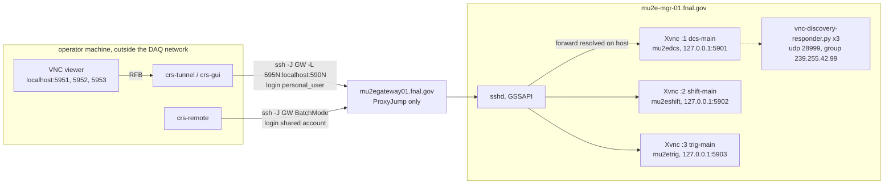
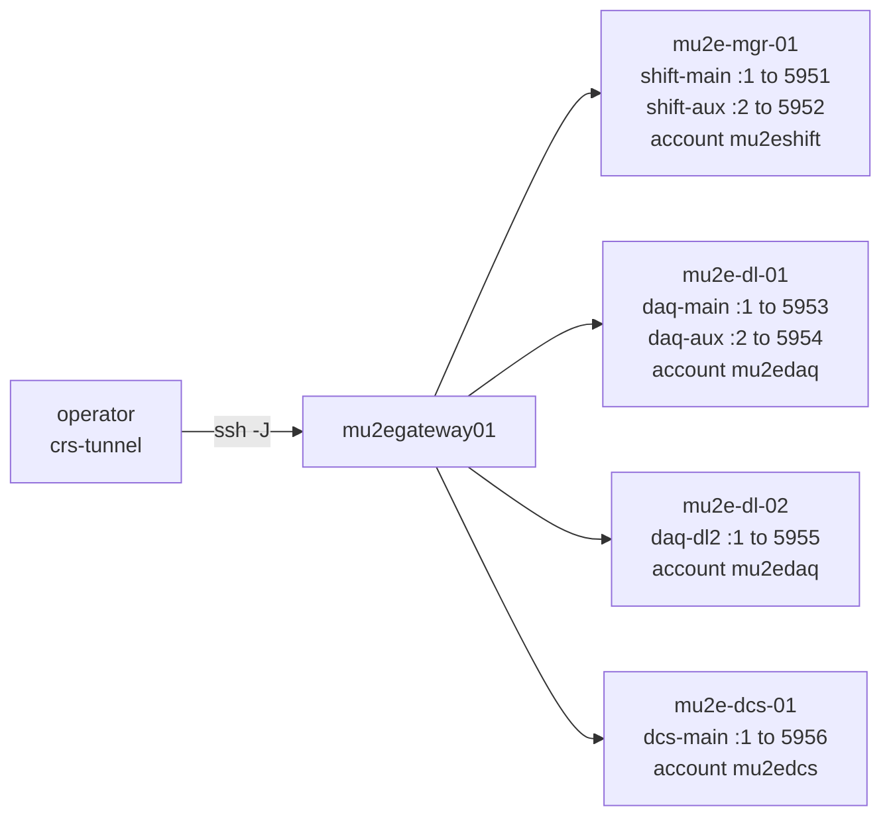
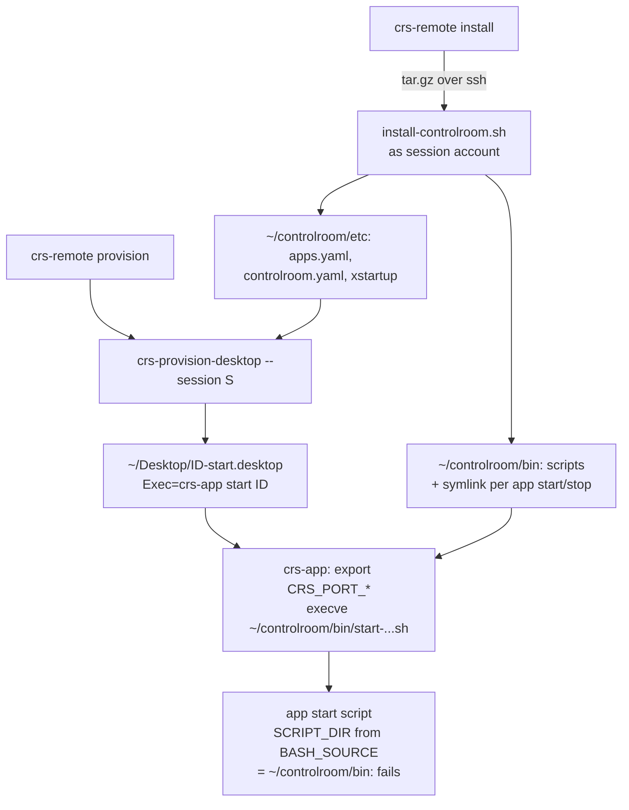

# mu2edaq-controlroom-setup

> Provisions and drives the Mu2e control-room VNC desktops from outside the DAQ network: ssh/Kerberos tunnels through the FNAL gateway, remote VNC lifecycle and host install, XFCE launchers that start each DAQ app with its inventory ports, and a discovery sidecar per session.

| | |
|---|---|
| Repository | `Mu2e/mu2edaq-controlroom-setup` (public) |
| Language | Python 3.9+ (PyYAML, PyQt6 optional), bash; host side stdlib-only |
| Version | 1.0.0 (`pyproject.toml:7`, `__init__.py:7`) |
| Ports | client: 5951–5953/tcp loopback tunnel listeners; host: VNC 5901–5903/tcp loopback, 28999/udp discovery responder |
| Depends on | `mu2edaq-discovery` (client GUI + host sidecar, both optional at import), the 12 DAQ apps (by exec), ssh/Kerberos, TigerVNC, XFCE |

## Purpose

Shifters work on shared XFCE desktops running in VNC servers on DAQ hosts.
Those servers must never be reachable from the network. This package is
the whole access and provisioning chain around them:

- **client side** (operator laptop): `crs-tunnel` and `crs-gui` keep one
  Kerberos-authenticated ssh forward per session through
  `mu2egateway01`; `crs-remote` runs the host-side scripts over ssh.
- **host side** (`server/`, shipped by `crs-remote install`, no venv):
  start/stop/status a VNC session, advertise it to `mu2edaq-discovery`, and
  write desktop launchers that run each DAQ app through `crs-app` with its
  `CRS_PORT_*` assignments.
- **suite contract**: `templates/` and `doc/issues/` are how the
  start/stop and discovery conventions were imposed on every other app.

It supersedes the VNC-tunnel half of `mu2edaq-controlroom`
(`sshutil.py:4-5`, `tunnels.py:5` say "generalizes
`start_vnc_tunnels_mu2e.sh`"; `viewer.py:3-5` follows the NOvA `Tools.py`
AttachVNC pattern).

## Architecture

### Topology as configured (what the tools act on)

Source: `config/controlroom.yaml:20-41`, since commit `da08771`
(2026-06-25, "replace the 6-session design layout with the three sessions
currently running on mu2e-mgr-01").

### Six-session design (README and superproject runbooks only)

`README.md:23-32` still documents the original design, and so do the
superproject's `DAQ-ControlRoom-Instructions.md:34-41` and
`DAQ-ControlRoom-Testing.md:188-240`, whose smoke test runs
`crs-remote start --session daq-dl2` — a name the shipped
`controlroom.yaml` no longer defines, so that command exits 1 with
"no session named 'daq-dl2'" (`session.py:47-48`). Nothing in the code or
config implements the six-session layout today; `config/apps.yaml` still
assigns apps to its session names. Which layout the hosts actually run was
not verified live in this review (CRS-002).

### Security boundary

VNC listens on loopback only — enforced by `vncserver … -localhost yes`
at `server/start-vnc-session.sh:51`, and only there. The tunnel's far end
`localhost:590N` is resolved by sshd on the session host
(`sshutil.py:59`), and every ssh goes through `-J gateway` with GSSAPI
(`sshutil.py:36-42`). The only network-facing surfaces are the two sshds.
Inside the host, any account that can ssh in can reach every session's
loopback port; the per-session gate is the VNC password. Hardening gaps
(credential delegation into shared accounts, unpinned local bind):
CRS-007. Full table: [INTERFACES.md §2](INTERFACES.md).

The enforcement is a property of *this script's* invocation, not of the
host. A session started any other way — a systemd `vncserver@:N` unit, or
`vncserver` by hand — binds wherever the host's TigerVNC configuration
says. Commit `da08771` describes the three configured sessions as
"currently running on mu2e-mgr-01" without saying what started them, so
whether the live sessions are loopback-only was not established by this
review; `ss -ltn 'sport = :5901'` on the host settles it (local address
must be `127.0.0.1` or `::1`).

### Provisioning and launch data flow

The last box is CRS-001: the symlink step and every app's unresolved
`SCRIPT_DIR` combine so that no desktop launcher can start its app while
the symlink exists.

## Components

| Path | Lines | Role |
|---|---|---|
| `src/mu2edaq_controlroom_setup/config.py` | 138 | load and validate `controlroom.yaml`; `load_apps` validator (used only by tests) |
| `session.py` | 52 | `Session`, `ControlRoomConfig` |
| `sshutil.py` | 71 | ssh argv builders, `klist -s` preflight, control-socket paths |
| `tunnels.py` | 86 | `TunnelManager`: open/close/status via ControlMaster sockets |
| `remote.py` | 109 | `RemoteRunner`: remote commands, payload tar, target selection |
| `viewer.py` | 48 | macOS `open vnc://`, else `vncviewer -Shared` |
| `cli.py` | 129 | `crs-tunnel`, `crs-remote` |
| `gui/main.py`, `gui/tunnels_tab.py`, `gui/discovery_tab.py` | 72, 133, 154 | `crs-gui` |
| `server/start-vnc-session.sh`, `stop-…`, `status-…` | 71, 36, 40 | VNC lifecycle on the host |
| `server/vnc-discovery-responder.py` | 170 | discovery sidecar, with embedded protocol fallback |
| `server/crs-app` | 122 | exec an app's start/stop script with `CRS_PORT_*` |
| `server/crs-provision-desktop` | 128 | write session launchers |
| `server/install-controlroom.sh` | 97 | host install, PATH stanza, app script symlinks |
| `server/xstartup` | 14 | XFCE session with `~/controlroom/bin` on PATH |
| `bin/start-controlroom.sh`, `bin/stop-controlroom.sh` | 17, 15 | all sessions up/down |
| `templates/` | 5 files | start/stop script and man-page templates for app repos |
| `doc/` | | static HTML site, `usage.md`, `issues/` (22 tickets), these review docs |

### Threading model

`crs-gui`'s Tunnels tab runs every ssh operation in a `QThread`
(`_TunnelWorker`, `gui/tunnels_tab.py:20-52`) and refreshes every 15 s
(`:17`, `:66-68`); results return by `pyqtSignal`. The Discovery tab scans
in a `QThread` (`gui/discovery_tab.py:27-64`). One exception:
double-clicking a VNC row calls `TunnelManager.open` — a blocking
`ssh -f` — directly on the UI thread (`gui/main.py:41-44`), freezing the
window for the authentication round trip (CRS-010). The CLIs are
single-threaded and sequential; the first failing `open` aborts the rest
(`cli.py:52-76`).

## Interfaces

[INTERFACES.md](INTERFACES.md): `controlroom.yaml` schema (§1), the
access path and who logs in as whom (§2), the CLIs (§3), host payload
(§4), `apps.yaml` `sessions:` and `crs-app` (§5), the start/stop template
(§6), the VNC ANNOUNCE and its deployment constraint (§7).

## Configuration

`config/controlroom.yaml` (sessions, gateway, `personal_user`, discovery)
and `config/apps.yaml` (shared inventory, plus `sessions:`). Precedence
command line > `CRS_*` env > YAML > defaults (`config.py:1-12`). Four keys
are read and never used (CRS-006). There is no `.env` reader.

## Operations

[OPERATIONS.md](OPERATIONS.md); step-by-step operator guide in
[usage.md](usage.md).

## Interactions with other packages

| Package | Direction | Mechanism | Evidence |
|---|---|---|---|
| `mu2edaq-discovery` | out | import `discover()` in the client GUI | `src/mu2edaq_controlroom_setup/gui/discovery_tab.py:40` |
| `mu2edaq-discovery` | out | import `Responder` in the host sidecar under system `python3`, embedded fallback otherwise | `server/vnc-discovery-responder.py:24` |
| the 12 DAQ apps | out | `crs-app` `execve`s each app's start/stop script | `config/apps.yaml:20-130`, `server/crs-app:118` |
| `mu2edaq-desktop` | peer | same inventory schema, hand-copied | `../mu2edaq-desktop/config/apps.yaml:3-4` |
| `mu2edaq-controlroom` | legacy | superseded tunnels; still named as the Kerberos remedy | `src/mu2edaq_controlroom_setup/sshutil.py:22`, `README.md:46` |

### `crs-app` versus desktop's `mu2edaq-app`

The two launchers read the same `apps.yaml` schema — the shared fields of
the two inventory copies are identical for all 12 ids (diffed in
`mu2edaq-desktop/docs/INTERFACES.md` §1.5; that table is the divergence
record and is not repeated here) — and export `CRS_PORT_<NAME>` identically
(`server/crs-app:115-116`). Beyond that they have **drifted**
(row-by-row comparison in `mu2edaq-desktop/docs/INTERFACES.md` §2.1):
`crs-app` resolves the script through the `~/controlroom/bin` symlink
first and `execve`s it with inherited stdio and cwd; `mu2edaq-app` runs
`install_path/<script>` under `subprocess.run` with cwd = checkout and a
captured stdout, defaults `install_path`, and adds `status`. Each has one
defect the other does not: here CRS-001 (symlink → wrong `SCRIPT_DIR`),
there DESK-002 (captured stdout blocks on controlcenter). `crs-app`
additionally has a PyYAML-free fallback parser (CRS-014) and consumes
`sessions:`; desktop consumes `status:`. Each reader silently drops the
other's extension key.

One correction to the desktop record: its §1.5 says nine of twelve apps
are assigned only to undefined sessions; the count is **eight** (dashboard,
diskwatcher, fts, heartbeatmonitor, resource-manager, runlog-db,
dataformat-viewer, cfocontrol). bigredbox lists `shift-main` as well as
`shift-aux`.

### The integration tickets (`doc/issues/`)

22 tickets (not 12): 11 start/stop standardization, 11 discovery
adoption, written 2026-06-12 in commit `2335b7c`. `doc/issues/README.md:5`
still calls them "drafts — do not submit without explicit approval"; all
22 were filed and all are closed (`gh issue list`, 2026-10-06):

| # | Repo | Ticket | Filed | Outcome in tree |
|---|---|---|---|---|
| 01 | bigredbox | rename to `start-/stop-mu2edaq-bigredbox.sh`, honour `DISPLAY`, `CRS_PORT_UDP` | #2 closed | script present, reads `CRS_PORT_UDP` |
| 02 | CFOControl | add start/stop (interactive terminal tool) | #1 closed | present, `CRS_PORT_MACROMAKER` |
| 03 | controlcenter | rename `start.sh`, `CRS_PORT_CMD` | #1 closed | present; old names kept as symlinks |
| 04 | dashboard | rename, add stop, `CRS_PORT_HTTP`/`ZMQ` | #2 closed | present |
| 05 | dataformat-viewer | add start/stop, `CRS_PORT_LISTEN` | #1 closed | present |
| 06 | diskwatcher | rename, `CRS_PORT_HTTP` | #1 closed | present |
| 07 | fts | rename, `CRS_PORT_HTTP` | #1 closed | present; 5003 |
| 08 | heartbeatmonitor | add scripts; **move HTTP 8080→8081** (resource-manager collision) | #1 closed | present |
| 09 | resource-manager | top-level start/stop, `CRS_PORT_HTTP` | #5 closed | present, maps to `RM_PORT` |
| 10 | runlog-db | rename, add stop, `CRS_PORT_HTTP` | #1 closed | present, maps to `RUNLOGDB_PORT` |
| 11 | trigger-scalers | add wrappers; **move UDP 5555→5557** (dashboard ZMQ collision) | #1 closed | present |
| 12–21 | bigredbox #3, controlcenter #2, dashboard #3, dataformat-viewer #2, diskwatcher #2, downtime-logger #1, fts #2, heartbeatmonitor #2, resource-manager #6, runlog-db #2 | embed `mu2edaq_discovery.Responder` after bind, stop on shutdown, `meta` as strings | all closed | `Responder(` present in each (e.g. `../mu2edaq-dashboard/dashboard.py:1089`, `../mu2edaq-fts/mu2edaq_fts.py:236`, `../mu2edaq-controlcenter/src/controlcenter.py:101`) |
| 22 | trigger-scalers | discovery "blocked on C++ library"; proposed an interim **system-`python3` sidecar** | #2 closed | implemented with the C++ `Responder` (`../mu2edaq-trigger-scalers/src/main.cpp:91-108`); the sidecar idea is the origin of the earlier mis-attribution corrected in CONTRACT §9.4 |

Issue numbers were matched by exact title with `gh issue list --state all`
on 2026-10-06; every one of the 22 is closed.

What the paper trail shows:

1. The convention reached all 12 apps, including downtime-logger, which
   had no start/stop ticket — and is the one whose script ignores its
   `CRS_PORT_HTTP` (mu2edaq-desktop DESK-003). CFOControl had no discovery
   ticket and has no responder.
2. Ticket 01 states the installer "symlinks every app's standardized
   `start-<app>.sh` … into a single `~/controlroom/bin`", yet no ticket
   asked the scripts to resolve their own path through a link; every
   adopter used `dirname "${BASH_SOURCE[0]}"` (CRS-001).
3. The two port moves recorded in `config/apps.yaml:83`, `:113` were
   negotiated through tickets 08 and 11; the inventory is where the
   result was written down, which is how it became the port registry.

## Testing

43 pytest tests (`tests/test_config.py` 13, `test_tunnels.py` 12,
`test_desktop.py` 8, `test_remote.py` 7, `test_viewer.py` 3): 42 pass, 1
`xfail` — `test_shipped_apps_config_is_valid`, which documents the orphaned
`sessions:` references. `test_desktop.py` runs the real
`server/crs-provision-desktop` and `install-controlroom.sh` against a temp
`CRS_HOME`. Not covered: the sidecar (either implementation), `crs-app`'s
exec path through a symlink, the GUI, and the template. No CI.
`README.md:97` says 38 tests.

| Platform | Client | Host side | Tests |
|---|---|---|---|
| AlmaLinux 9 / Python 3.9 | supported | the only target (`vncserver`, XFCE) | not run in this review |
| macOS / Python 3.12 | supported; Screen Sharing viewer | n/a | 42 pass, 1 xfail (2026-10-06) |
| Windows 11 | `vncviewer` path only; ssh/Kerberos untested | n/a | — |

## Review findings

Staged in [ISSUES-PENDING.md](ISSUES-PENDING.md). The inventory triplication
is staged once, in `mu2edaq-desktop` (DESK-001).

| ID | Sev | Title |
|---|---|---|
| CRS-001 | S2 | `crs-app` runs the `~/controlroom/bin` symlink, so every adopted start script resolves `SCRIPT_DIR` to the bin area and fails |
| CRS-002 | S3 | session topology disagrees: `controlroom.yaml` (3 on mgr-01), README and superproject runbooks (6 on 4 hosts), `apps.yaml` (8 of 12 apps only on undefined sessions) |
| CRS-003 | S3 | `crs-remote` and the GUI gateway scan log in as the shared accounts that `da08771` found refuse the operator's principal |
| CRS-004 | S3 | nothing installs `mu2edaq-discovery` for the host's system `python3`; the embedded fallback diverges and dies on a malformed DISCOVER |
| CRS-005 | S4 | start template lets `--config` override `CRS_PORT_*`, inverting its documented precedence (no adopter uses the config layer) |
| CRS-006 | S3 | `install_dir`/`CRS_INSTALL_DIR`, `vnc_password_file`, `accounts`, `discovery.announce_interval` parsed but never used; remote paths hard-coded |
| CRS-007 | S3 | ssh hardening: credential delegation into shared accounts; local forward not pinned to loopback |
| CRS-008 | S3 | Kerberos hint sends operators to the legacy `mu2e-krb-cron.py`, which destroys a personal ticket |
| CRS-009 | S3 | no CI for a 43-test suite |
| CRS-010 | S4 | discovery-tab connect opens the tunnel on the UI thread |
| CRS-011 | S4 | `pyproject.toml` declares BSD-3-Clause; `LICENSE` is MIT |
| CRS-012 | S4 | `doc/issues/README.md` still calls the 22 filed tickets drafts; README test count stale |
| CRS-013 | S4 | man pages: two misnamed, `.TH` without version, six executables undocumented (fixed in this review) |
| CRS-014 | S4 | host fallback YAML parser: `--all-local` finds no sessions and every launcher gets `Terminal=true` |

Already open upstream and not re-filed: `Mu2e/mu2edaq-controlroom-setup#4`
(`requirements.txt` lists PyQt6 unconditionally, `pyproject.toml` makes it
an extra).
